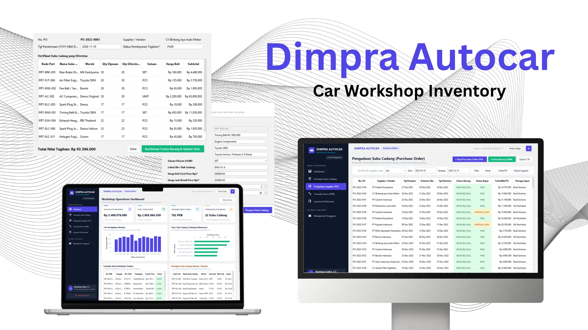
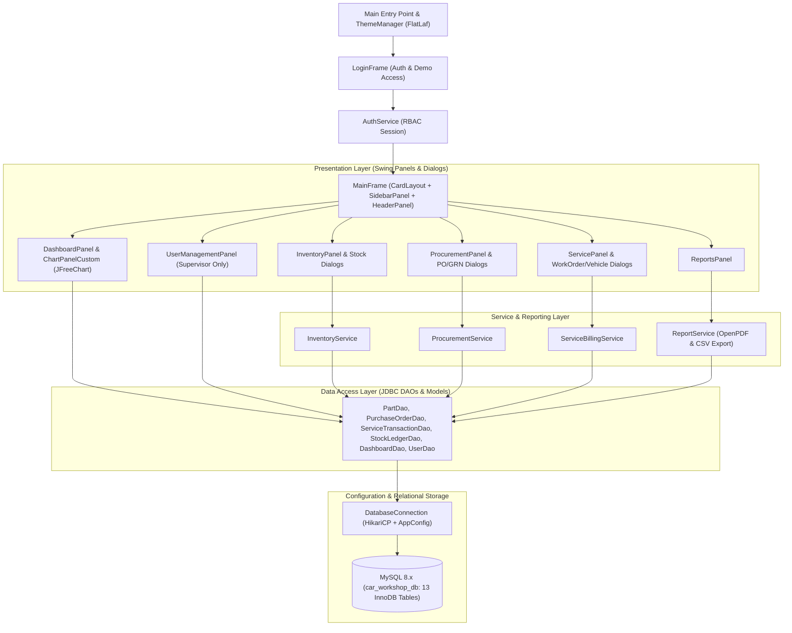
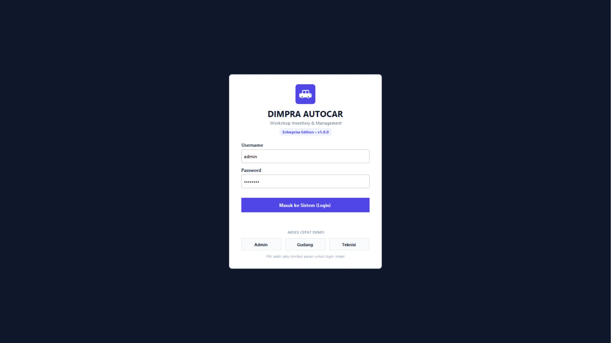
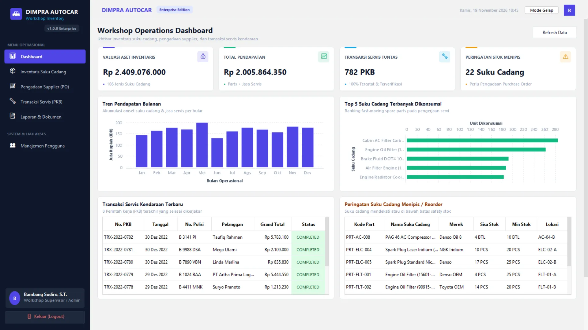
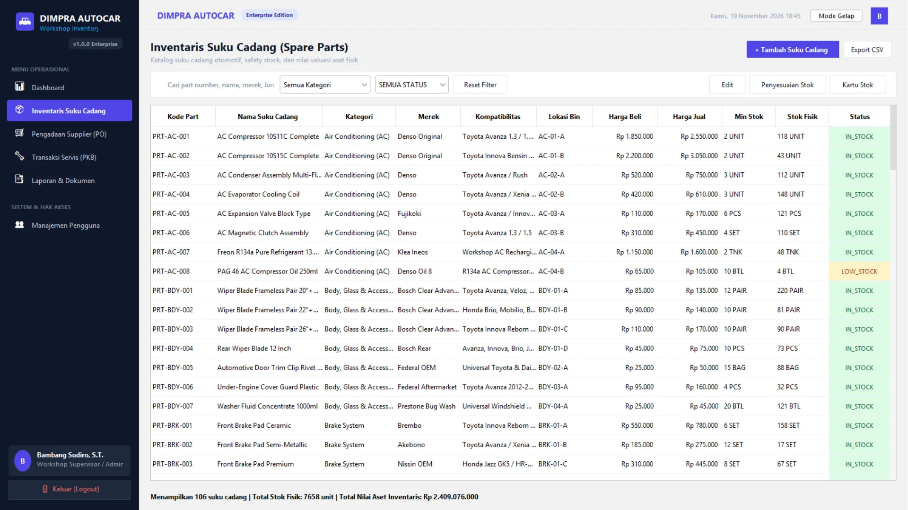
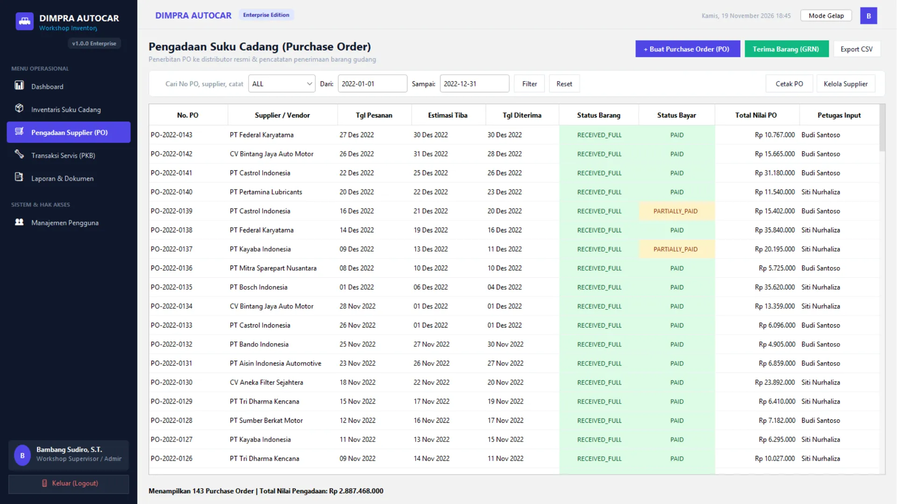
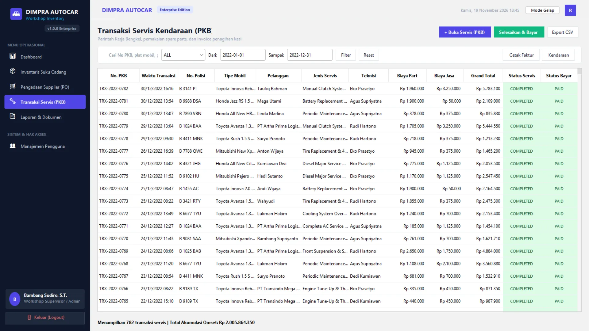
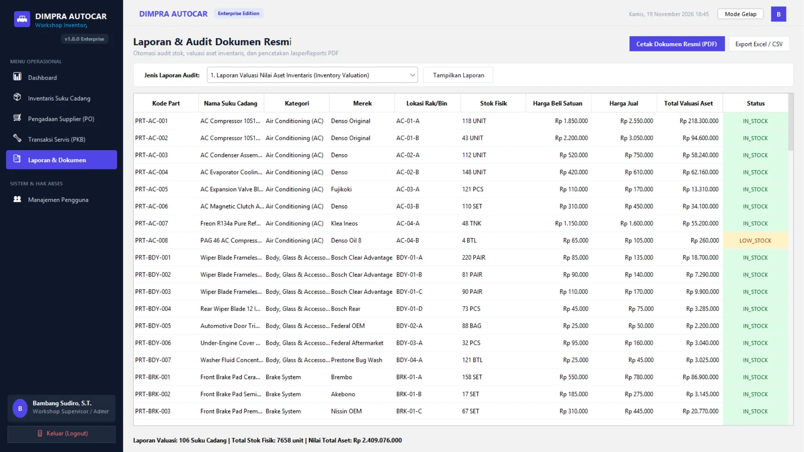
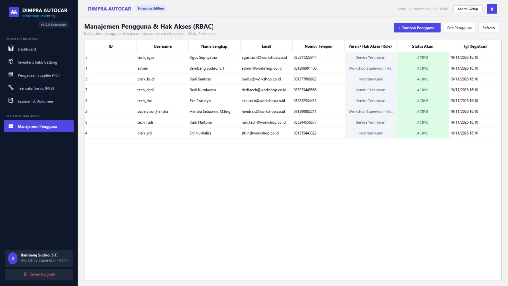

# Dimpra Autocar - Car Workshop Inventory




## Project Overview

Dimpra Autocar - Car Workshop Inventory is a standalone Java desktop management application built for automotive repair workshops to centralize spare parts inventory control, supplier procurement, customer vehicle servicing, and financial reporting. It replaces fragmented manual spreadsheets and paper work orders with a unified transactional workspace backed by a relational MySQL database and connection pooling. Workshop supervisors, inventory clerks, and service technicians operate within role-scoped workflows covering real-time stock tracking, automated stock ledger auditing, purchase order receiving, service invoice billing, and PDF/CSV report generation.

## Key Features

- **Role-Based Authentication & Access Control (RBAC)**: Authenticates users against SHA-256 hashed credentials across three roles (`WORKSHOP_SUPERVISOR`, `INVENTORY_CLERK`, and `SERVICE_TECHNICIAN`), restricting system user management to supervisors and offering one-click demo access buttons on the login screen.
- **Executive Workshop Operations Dashboard**: Displays four live KPI cards (Inventory Asset Valuation, Total Revenue, Completed Service Orders, and Low Stock Alerts), interactive JFreeChart bar charts for monthly revenue trends and top-consumed parts, and tables for recent work orders and reorder warnings.
- **Spare Parts Catalog & Stock Ledger Auditing**: Manages spare parts across 12 automotive categories with storage bin locations, vehicle compatibility notes, cost/selling prices, safety-stock thresholds (`IN_STOCK`, `LOW_STOCK`, `OUT_OF_STOCK`, `DISCONTINUED`), manual stock adjustments, and per-part chronological `stock_ledger` audit trails.
- **Supplier Procurement & Goods Receipt (GRN)**: Supports creating multi-item purchase orders (`PO`), tracking order and payment statuses (`DRAFT`, `ORDERED`, `RECEIVED_PARTIAL`, `RECEIVED_FULL`, `PAID`, `PARTIALLY_PAID`, `UNPAID`), managing supplier directories, and atomically updating inventory and ledger records upon goods receipt.
- **Vehicle Service Transactions & Billing (PKB)**: Registers customers and vehicles (plate number, VIN, make/model, transmission, odometer), creates repair work orders combining consumed spare parts and hourly labor items, calculates discounts and 11% VAT (`PPN 11%`), deducts stock transactionally, and records payment settlements (`CASH`, `TRANSFER`, `DEBIT_CARD`, `CREDIT_CARD`, `QRIS`).
- **Official PDF & CSV Reporting Suite**: Generates formatted A4 PDF documents via OpenPDF—including service invoices, purchase orders, inventory valuation reports, and individual part stock cards—alongside five interactive audit report previews with CSV export across operational tables.
- **Light & Dark Theme Switching**: Built with FlatLaf (`FlatLightLaf` and `FlatDarkLaf`), allowing instant runtime UI theme toggling from the top application header bar.

## Supported Platforms

| Platform | Operating System | Minimum Version | Support / Test Status |
| :--- | :--- | :--- | :--- |
| Windows Desktop | Microsoft Windows | Windows 10 (x64) | Configured, built, and launched via `run.bat` and `start-mysql-and-app.bat` |
| JVM Desktop (macOS / Linux) | macOS / Linux | Java 17 Runtime (JRE/JDK 17+) | Compatible via standalone Fat JAR (`java -jar`); not tested on non-Windows hosts |

## Tech Stack

| Category | Technology | Purpose |
| :--- | :--- | :--- |
| Programming Language | Java | Core application logic, models, DAOs, and desktop UI |
| Desktop UI Framework | Java Swing & FlatLaf | Modern desktop windowing, custom components, and Light/Dark theming |
| Data Visualization | JFreeChart | Monthly revenue vertical bar chart and top consumed parts horizontal bar chart |
| PDF Generation | OpenPDF | Programmatic generation of invoices, purchase orders, valuation reports, and stock cards |
| Database | MySQL | Relational persistence across 13 normalized InnoDB tables (`car_workshop_db`) |
| Connection Pooling | HikariCP | High-performance JDBC connection pool (`CarWorkshopPool`) with prepared-statement caching |
| Logging | SLF4J Simple | Runtime logging for HikariCP and application diagnostics |
| Build & Packaging | Apache Maven | Dependency management, compilation, and Fat JAR assembly via `maven-assembly-plugin` |
| Data Seeding Tooling | Python & SQL | Deterministic 2022 automotive dataset generator (`scripts/generate_dummy_data_2022.py`) and SQL schema/seed scripts |

## Application Architecture

The application follows a four-tier desktop architecture hosted inside a single JVM process, separating Swing presentation panels from transactional business services, JDBC Data Access Objects (DAOs), and the MySQL persistence engine. `Main` initializes `ThemeManager`, validates database connectivity through `DatabaseConnection`, and launches `LoginFrame`; upon authentication via `AuthService`, `MainFrame` coordinates module switching through a `CardLayout` paired with `SidebarPanel` and `HeaderPanel`. Transactional workflows—such as goods receiving in `ProcurementService`, stock adjustments in `InventoryService`, and repair billing in `ServiceBillingService`—coordinate multi-table writes under explicit JDBC transactions (`setAutoCommit(false)` / `commit()` / `rollback()`) so `parts` quantities and `stock_ledger` audit entries remain consistent.



## Screenshots / Preview

### 1. Role-Based Login & Demo Access Screen

The authentication window presents a centered white card over a dark Slate 900 backdrop featuring the Dimpra Autocar brand badge, username and password fields, primary login trigger, and three instant demo role selectors (`Admin`, `Gudang`, `Teknisi`).

### 2. Workshop Operations Dashboard

The main dashboard provides a dark left navigation sidebar, a top header bar with live timestamp and Dark Mode toggle, four KPI summary cards, two JFreeChart analytics panels for monthly revenue and top-consumed parts, and dual tables tracking recent PKB transactions and low-stock reorder alerts.

### 3. Spare Parts Inventory Catalog

The inventory workspace lists 106 automotive spare parts with category and status filters, instant search across part numbers, brands, and storage bins, color-coded stock badges (`IN_STOCK`, `LOW_STOCK`), and toolbar actions for part editing, stock adjustments, stock card inspection, and CSV export.

### 4. Supplier Procurement & Purchase Orders

The procurement module tracks 143 supplier purchase orders with date-range and status filters, fulfillment and payment status badges (`RECEIVED_FULL`, `PAID`, `PARTIALLY_PAID`), and dedicated controls to issue new POs, record Goods Receipt Notes (`Terima Barang (GRN)`), print PO PDFs, and manage vendors.

### 5. Vehicle Service Transactions & Billing (PKB)

The service transactions screen manages 782 vehicle repair work orders (`PKB`), displaying license plates, vehicle models, customer names, assigned technicians, part and labor subtotals, grand totals, and actions to open new work orders, finalize payment, print invoices, and manage customer vehicles.

### 6. Reports & Official Document Audit

The reporting console offers five audit views—Inventory Valuation, Parts Consumption Audit, Complete Stock Ledger Audit, Monthly Financial Revenue, and Low Stock Warnings—with live tabular previews and one-click export to formatted OpenPDF documents or CSV spreadsheets.

### 7. User Management & RBAC Access Control

Accessible exclusively to users with the `WORKSHOP_SUPERVISOR` role, this panel manages staff accounts across supervisor, inventory clerk, and service technician roles, displaying role badges, account active status, registration timestamps, and account creation or editing dialogs.

## Prerequisites

- **Operating System**: Microsoft Windows 10 or Windows 11 (or macOS/Linux with Java 17+ to execute the JAR directly).
- **Java Runtime / SDK**: Java Development Kit (JDK) or Java Runtime Environment (JRE) 17 or newer (`java` available on `PATH`).
- **Build Tool**: Apache Maven 3.9+ (bundled portable binary `apache-maven-3.9.6/` is included in the workspace, or use a system Maven installation).
- **Database Server**: MySQL 8.x running on port `3306` (e.g., via Laragon, XAMPP, or standalone MySQL Server).
- **Optional (Data Regeneration)**: Python 3.x if regenerating `sql/seed_data_2022.sql` via `scripts/generate_dummy_data_2022.py`.

## Installation & Setup

1. Clone the repository and navigate into the project directory:
   ```powershell
   git clone https://github.com/weztcy/Dimpra-Autocar-Car-Workshop-Inventory.git
   cd "Dimpra Autocar - Car Workshop Inventory"
   ```

2. Ensure MySQL 8.x is running on `127.0.0.1:3306`, then create the database and load the schema and 2022 seed dataset:
   ```powershell
   mysql -u root -e "CREATE DATABASE IF NOT EXISTS car_workshop_db CHARACTER SET utf8mb4 COLLATE utf8mb4_unicode_ci;"
   mysql -u root car_workshop_db < sql/schema.sql
   mysql -u root car_workshop_db < sql/seed_data_2022.sql
   ```

3. Verify or update the database credentials in `src/main/resources/database.properties` if your MySQL instance uses a non-empty password or custom port.

4. Build the executable Fat JAR using the bundled Maven binary or system Maven:
   ```powershell
   .\apache-maven-3.9.6\bin\mvn.cmd clean package
   ```

5. Launch the application using the packaged JAR or the Windows batch launcher:
   ```powershell
   .\run.bat
   ```

## Application Configuration

Database connection parameters and HikariCP pool sizing are externalized in `src/main/resources/database.properties` and loaded at startup by `AppConfig` and `DatabaseConnection`, while workshop branding and invoice metadata (such as workshop address and 11% VAT tax ID) are defined as constants in `com.workshop.config.AppConfig`.

| Configuration | Description | Default / Example |
| :--- | :--- | :--- |
| `db.host` | Hostname or IP address of the MySQL server | `127.0.0.1` |
| `db.port` | TCP port where MySQL listens | `3306` |
| `db.database` | Target relational schema name | `car_workshop_db` |
| `db.username` | MySQL database user account | `root` |
| `db.password` | MySQL password for the configured user | `""` (empty string) |
| `db.pool.maximumPoolSize` | Maximum concurrent connections in `CarWorkshopPool` | `10` |
| `db.pool.minimumIdle` | Minimum idle connections retained by HikariCP | `2` |
| `db.pool.idleTimeout` | Idle connection timeout in milliseconds | `30000` |
| `db.pool.connectionTimeout` | Maximum wait time for a pool connection in milliseconds | `10000` |

## Database & Local Storage

All operational records are persisted in a local or network MySQL 8.x database (`car_workshop_db`) using InnoDB tables with `utf8mb4_unicode_ci` collation and foreign-key constraints defined in `sql/schema.sql`. There is no separate local SQLite or file-based store; PDF and CSV exports are written directly to user-selected filesystem locations.

| Component | Technology | Storage Details |
| :--- | :--- | :--- |
| Primary Relational Store | MySQL 8.x (`InnoDB`) | 13 tables: `users`, `categories`, `suppliers`, `parts`, `stock_ledger`, `purchase_orders`, `purchase_order_items`, `customers`, `vehicles`, `service_transactions`, `service_parts_used`, `service_labor_items`, `stock_adjustments` |
| Connection Pool | HikariCP | Configured with `cachePrepStmts=true`, `prepStmtCacheSize=250`, and `prepStmtCacheSqlLimit=2048` |
| Seed Dataset | SQL (`sql/seed_data_2022.sql`) | Pre-populated 2022 workshop dataset generated by `scripts/generate_dummy_data_2022.py` |

```sql
CREATE DATABASE IF NOT EXISTS car_workshop_db CHARACTER SET utf8mb4 COLLATE utf8mb4_unicode_ci;
SOURCE sql/schema.sql;
SOURCE sql/seed_data_2022.sql;
```

## Authentication & Authorization

User authentication and role-based access control (RBAC) are implemented in `AuthService`, `UserDao`, and `SecurityUtil`. Passwords are verified using SHA-256 hex digests (with plaintext fallback compatibility in `SecurityUtil.checkPassword` for development seed records).

- **Roles (`com.workshop.model.Role`)**:
  - `WORKSHOP_SUPERVISOR` (`Workshop Supervisor / Admin`): Full access to all operational panels plus `Manajemen Pengguna` (`UserManagementPanel`) for creating and editing staff accounts.
  - `INVENTORY_CLERK` (`Inventory Clerk`): Access to operational inventory, procurement, service, and reporting workspaces; `UserManagementPanel` is excluded from `MainFrame` navigation.
  - `SERVICE_TECHNICIAN` (`Service Technician`): Access to operational workspaces for workshop servicing, inventory lookup, and reporting; `UserManagementPanel` is excluded from navigation.
- **Session Handling**: `AuthService` maintains the active `User` singleton in memory for the desktop session and clears it upon logout confirmation in `MainFrame`.

## Testing

The repository provides an integration verification runner in `src/test/java/com/workshop/SystemVerificationTest.java` that exercises live database connectivity, role logins, catalog valuation, purchase order counts, service transaction totals, stock ledger records, dashboard KPIs, and four OpenPDF exports into `test_reports_output/`.

- **Database & Auth Checks**: Verifies `DatabaseConnection.testConnection()` and `AuthService.login()` for supervisor (`admin`), clerk (`clerk_budi`), and technician (`tech_agus`) accounts.
- **Domain & KPI Checks**: Queries `PartDao`, `PurchaseOrderDao`, `ServiceTransactionDao`, `StockLedgerDao`, and `DashboardDao` against the seeded `car_workshop_db` schema.
- **PDF Export Checks**: Generates sample PDFs (`Test_Invoice_TRX_1.pdf`, `Test_PO_1.pdf`, `Test_Valuation_Report.pdf`, and `Test_Stock_Card_Part_1.pdf`) under `test_reports_output/`.

```powershell
.\apache-maven-3.9.6\bin\mvn.cmd test-compile exec:java "-Dexec.mainClass=com.workshop.SystemVerificationTest" "-Dexec.classpathScope=test"
```

## Build & Packaging

Maven builds both a standard thin JAR and a self-contained executable Fat JAR using `maven-assembly-plugin` (`jar-with-dependencies` descriptor) with `com.workshop.Main` set as the manifest `Main-Class`.

1. Compile sources and package the standalone JAR with all runtime dependencies bundled:
   ```powershell
   .\apache-maven-3.9.6\bin\mvn.cmd clean package
   ```
2. Verify the generated artifacts inside `target/`:
   - `target/car-workshop-inventory-1.0.0-jar-with-dependencies.jar` (standalone executable Fat JAR)
   - `target/car-workshop-inventory-1.0.0.jar` (standard compiled JAR)

## Usage

After the MySQL database is initialized and the Fat JAR is built, launch and operate the workshop desktop workspace as follows:

1. Start the application by double-clicking `run.bat` (or `start-mysql-and-app.bat` if using Laragon's local MySQL binary) or executing:
   ```powershell
   java -jar target\car-workshop-inventory-1.0.0-jar-with-dependencies.jar
   ```
2. Sign in on `LoginFrame` with your credentials or click one of the quick-demo role buttons (`Admin`, `Gudang`, `Teknisi`).
3. Review real-time inventory valuation, annual revenue, completed service counts, and reorder alerts on the **Dashboard**; toggle Light/Dark mode anytime via the header button.
4. Use **Inventaris Suku Cadang** to search parts, add or edit catalog items, record stock adjustments, inspect part-level `Kartu Stok` ledgers, or export CSV.
5. Use **Pengadaan Supplier (PO)** to manage vendors, issue purchase orders, confirm Goods Receipt Notes (`Terima Barang (GRN)`), and print PO PDFs.
6. Use **Transaksi Servis (PKB)** to register customers and vehicles, create work orders with spare parts and labor items, settle payments, and print official service invoices.
7. Open **Laporan & Dokumen** to preview any of the five audit reports and export them to PDF or CSV.

## Contributing

Contributions to improve features, fix bugs, or refine database scripts are welcome through a standard pull request workflow.

1. Fork the repository.
2. Create a feature or bugfix branch from `main`.
3. Implement your changes cleanly while keeping `sql/schema.sql` and `pom.xml` consistent.
4. Compile and verify the changes against a local `car_workshop_db` instance using Maven.
5. Commit and push your branch to your fork.
6. Open a pull request describing the changes and verification steps.

## License

This project is licensed under the MIT License.
See the [LICENSE](LICENSE) file for details.

## Author & Contact

**Yohanes Dimas Pratama**

- GitHub: [github.com/weztcy](https://github.com/weztcy)
- Portfolio: [yohanesdimas.com](https://yohanesdimas.com)
- LinkedIn: [linkedin.com/in/yohanes-dimas](https://www.linkedin.com/in/yohanes-dimas)
